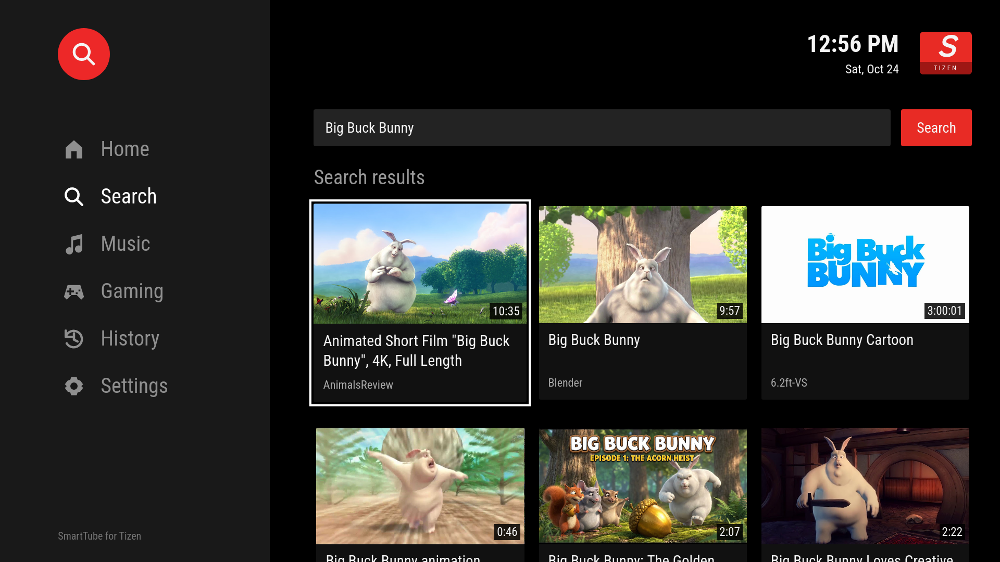

# SmartTube Tizen

An experimental, standalone YouTube client for Samsung Tizen TVs, inspired by [SmartTube](https://github.com/yuliskov/SmartTube). Built for the TV remote, with selectable video formats and SponsorBlock integration.

**Early development — unofficial and not feature-complete.** This is a Tizen web application, not an Android APK. It is not affiliated with or endorsed by SmartTube, YouTube, Samsung or SponsorBlock.



## What works

- Home, Search, Music and Gaming browsing with large thumbnails and remote focus navigation.
- Direct video playback with bundled HLS.js/MediaSource and a native Samsung AVPlay fallback.
- Video format selection from the available stream manifest, including resolution, codec and frame rate; persistent default maximum quality.
- Local viewing history and settings, without storing expiring stream URLs.
- SponsorBlock presets and automatic skip logic adapted from SmartTube.
- Bundled runtime assets: the installed application does not require a computer or local server to remain running.

## Tested status and limitations

Version **0.2.0** has been installed on one Samsung TV running **Tizen 6.5**. Search, playback and switching between decoded 720p and 480p were exercised with Big Buck Bunny; picture and audio at 720p were confirmed by the tester. The automated suite covers stream selection, timeouts, remote navigation, TV compatibility and player failures.

This is a starting point for community development, not a promise of playback on every video or TV:

- Accounts, subscriptions and full SmartTube feature parity are not implemented.
- 4K/HDR, live streams and other TV generations have not been validated.
- SponsorBlock skip logic is implemented and unit-tested; skipping a known segment on a physical TV still needs validation.
- Quality changes preserve pause state but can seek back about two seconds to a keyframe.
- Precise HLS quality selection is verified only on the MediaSource path. Native AVPlay fallback exposed only the lowest rendition of the tested manifest.
- Playback uses unofficial YouTube endpoints, which can change or require sign-in. The app stops on sign-in challenges. Universal ad-free playback is not guaranteed.
- An empty signed-out home feed falls back to local history or a labeled popular-video search.

## Build

Requires **Node.js 22 or newer**, npm, and **Python 3** on your PATH as `python3`.

```sh
git clone https://github.com/giilc/TizenSmartTube.git
cd TizenSmartTube
npm ci
npm test
npm run package
```

`npm run build` creates the bundled assets in `dist/`. `npm run package` also creates `SmartTubeTizen-0.2.0-unsigned.wgt`. **The unsigned package must be signed for your TV before installation.** Build output and signing credentials are not checked into this repository.

For a desktop layout preview, run `python3 -m http.server 8876 --directory dist` and open `http://localhost:8876`. A browser preview does not validate Samsung playback APIs or TV network permissions.

## Install on your TV

Use your own Samsung TV certificate profile. The public project does not include signing keys or a shared signing service. These are the official SDK steps; this specific personal-certificate workflow has not yet been independently tested end to end with this project.

1. Install [Tizen Studio with TV Extensions and Samsung Certificate Extension](https://developer.samsung.com/smarttv/develop/getting-started/setting-up-sdk/installing-tv-sdk.html). Put the SDK's `tools` and `tools/ide/bin` directories on your PATH so `sdb` and `tizen` are available.
2. Enable Developer Mode on your TV, set Host PC IP to your computer's LAN IP, and restart the TV. Connect the computer and TV to the same network. Follow Samsung's [TV device connection guide](https://developer.samsung.com/smarttv/develop/getting-started/using-sdk/tv-device.html).
3. In Certificate Manager, create a Samsung TV certificate profile that includes your TV's DUID. See [Creating Certificates](https://developer.samsung.com/smarttv/develop/getting-started/setting-up-sdk/creating-certificates.html). In Device Manager, connect to the TV and choose **Permit to install applications** if needed.
4. Build this project, then sign and install using the [Samsung TV CLI](https://developer.samsung.com/smarttv/develop/getting-started/using-sdk/command-line-interface.html):

```sh
# Replace placeholders with your own values; do not type the angle brackets.
sdb connect <TV_IP>
sdb devices

# The profile must already exist in Tizen Studio's Certificate Manager.
tizen package -t wgt -s <CERTIFICATE_PROFILE> -- dist

# Use the signed .wgt filename printed by the previous command.
# Use the target name shown by sdb devices.
tizen install -t <TARGET_NAME> -n <SIGNED_PACKAGE.wgt> -- dist
tizen run -t <TARGET_NAME> -p StTizen001.Port
```

Confirm the installer reports successful completion. If signing cannot find your profile, check the CLI profile configuration described in Samsung's guide. Certificate errors require a valid profile for that TV. Keep your author certificate for future updates; installing an update signed by a different author may fail.

## Remote controls

| Action | Control |
| --- | --- |
| Move around the sidebar or video grid | Arrow keys |
| Open a section or video | OK / Enter |
| Enter section content from the sidebar | Right |
| Show player controls | Up / Down during playback |
| Choose playback quality | Player controls → Video format |
| Seek 10 seconds | Left / Right with controls hidden |
| Close format dialog, controls, then playback | Back |
| Set default quality or SponsorBlock preset | Settings |

## Architecture

| File | Responsibility |
| --- | --- |
| `src/app.mjs` | UI, remote events and playback coordination |
| `src/provider.mjs` | On-device YouTube/SponsorBlock requests, validation and timeouts |
| `src/session.mjs` | YouTube.js browser session integration |
| `src/hls-player.mjs` | HLS.js/MediaSource lifecycle and format switching |
| `src/player.mjs` | Samsung AVPlay lifecycle and error handling |
| `src/formats.mjs` | Manifest parsing and audio/variant preservation |
| `src/core.mjs` | Video normalization and SponsorBlock skip decisions |
| `src/ui-state.mjs` | Focus movement, history and preferences |
| `src/polyfills.mjs` | Compatibility with the TV's Chromium 85 engine |

The manifest requires Tizen 6.0; this is a packaging minimum, not a compatibility guarantee. HLS.js workers are disabled for the TV environment. The content security policy permits dynamic script evaluation because YouTube.js evaluates extracted player logic for stream deciphering.

History and preferences stay in local app storage. Playback contacts YouTube/Google video services; SponsorBlock requests send the selected video ID to its public API. There is no project-operated backend or analytics service.

## Contribute

Issues and pull requests are welcome. See [CONTRIBUTING.md](CONTRIBUTING.md). Useful next steps are broader TV testing, SponsorBlock validation on real segments, playback reliability and additional SmartTube features. Include model year, Tizen version and reproducible steps when reporting a problem; remove account details, device identifiers and signed media URLs from logs.

## License and credits

Project source is available under the [MIT License](LICENSE). Dependencies and adapted code retain their own licenses; see [THIRD_PARTY_NOTICES.md](THIRD_PARTY_NOTICES.md).

Thanks to [SmartTube](https://github.com/yuliskov/SmartTube), [YouTube.js](https://github.com/LuanRT/YouTube.js), [HLS.js](https://github.com/video-dev/hls.js), [core-js](https://github.com/zloirock/core-js), [SponsorBlock](https://sponsor.ajay.app/) and the Roboto Condensed font contributors. The screenshot illustrates the app UI; displayed video thumbnails and titles belong to their respective creators and are not covered by the project's MIT license.
